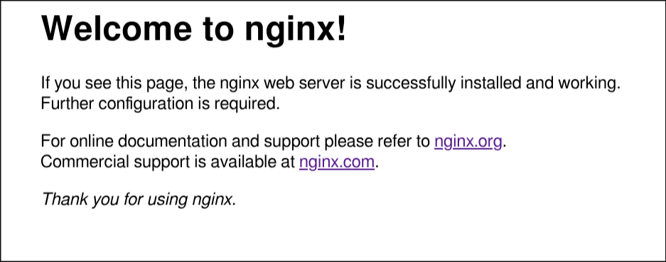
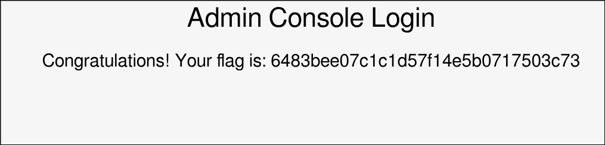
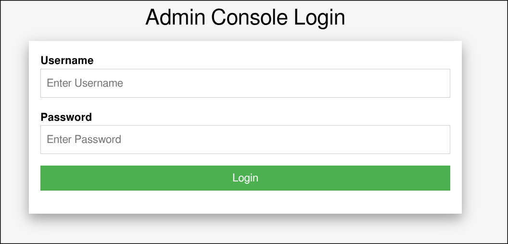

# [HackTheBox] [Preignition]: [Enumeration], [Foothold]

**Target:** [Preignition] | **OS:** Linux | **Difficulty:** Super Easy  
**Attack Vector:** [Enumeration -> Foothold]

---

## 1. Enumeration

```bash
sudo nmap -p- -sS ---min-rate 5000 -T3 10.129.122.174
```

`PORT   STATE SERVICE
80/tcp open  http`

Here we can see we have the port 80 open which is http, lets check the page



Nothing useful, lets try fuzzing its directories

```shell
➜ gobuster dir -u http://10.129.122.174/ -w /usr/share/seclists/Discovery/Web-Content/common.txt -t 50
===============================================================
Gobuster v3.8.2
by OJ Reeves (@TheColonial) & Christian Mehlmauer (@firefart)
===============================================================
[+] Url:                     http://10.129.122.174/
[+] Method:                  GET
[+] Threads:                 50
[+] Wordlist:                /usr/share/seclists/Discovery/Web-Content/common.txt
[+] Negative Status codes:   404
[+] User Agent:              gobuster/3.8.2
[+] Timeout:                 10s
===============================================================
Starting gobuster in directory enumeration mode
===============================================================
admin.php            (Status: 200) [Size: 999]
Progress: 4752 / 4752 (100.00%)
```

## 2. Foothold

Here it seems like it found something useful, lets try the subdomain



We have an Admin Console, since we dont have any credentials we can try using SQL Injection to log in without a password or user.

After a few tries i got nothing so went to try basic login credentials and `admin` in password and user worked

##. Flag



`6483bee07c1c1d57f14e5b0717503c73`


